# mono.tecno — Tienda online de hardware (SPA en Vue)

Trabajo Práctico Integrador Final · **Práctica Profesionalizante Desarrollo Web y Mobile**
Tecnicatura Superior en Diseño Multimedial · Docente: Facundo Romero

## Integrantes

- Ramiro Unrein

## Descripción del proyecto

SPA (Single Page Application) orientada a celulares para **mono.tecno**, un servicio técnico de PC de Ituzaingó que vende placas de video usadas (revisadas antes de publicarse) y otros componentes.

La app tiene dos partes:

- **Cuentas de clientes**: registro e inicio de sesión con email o **con Google**, y "Mi cuenta" con el historial de pedidos (cada pedido anterior se puede abrir, ver los datos de pago y "volver a comprar"); los datos se completan solos al comprar.
- **Tienda**: catálogo con buscador, filtros y orden, detalle de cada producto, carrito y compra en 3 pasos (datos, entrega y pago) con Mercado Pago, transferencia o efectivo.
- **Panel de administración** (`/admin`, con contraseña): alta, edición y baja de productos con foto (subida desde la computadora o por link), control de stock y pedidos con su estado.

Todo se guarda en **LocalStorage**, y la cotización del dólar se trae en vivo con **Fetch** desde DolarAPI para mostrar el precio aproximado en dólares.

Temática: **Catálogo de Productos**. Diseño basado en el estilo "Superhuman" de [Refero Styles](https://styles.refero.design/), con los colores del logo (azul noche `#0B0B2A` y magenta `#D63384`).

**Deploy:** https://mono-tecno-tienda.vercel.app
**Repositorio:** https://github.com/ramirounrein1-code/mono-tecno

## Tecnologías utilizadas

- Vue 3 (Options API)
- Vue CLI 5
- Vue Router 4
- LocalStorage
- Fetch API → [DolarAPI](https://dolarapi.com)
- Canvas API (logo de puntitos interactivo y achicado de fotos subidas)
- three.js (placa de video 3D en Nosotros, se carga solo en esa página y solo en computadora)
- HTML5 + CSS3 (mobile-first, sin frameworks de CSS)

## Instrucciones de instalación

Requisitos: Node.js 18 o superior.

```bash
npm install        # instalar dependencias
npm run serve      # servidor de desarrollo en http://localhost:8080
npm run build      # versión de producción en /dist
```

### Deploy en Vercel

1. Subir el repositorio a GitHub.
2. En Vercel: **Add New → Project** e importar el repositorio. Vercel detecta Vue CLI (build `npm run build`, salida `dist`).
3. El archivo `vercel.json` redirige todas las rutas a `index.html`, así funcionan los links directos como `/productos/p04`.

## Accesos para probar

| Qué | Dónde | Datos |
|---|---|---|
| Cuenta de cliente | `/cuenta/ingresar` | `ramirounrein1@gmail.com` · contraseña `isec` |
| Panel de administración | `/admin` (o desde "Mi cuenta" con la cuenta de arriba) | contraseña `isec` |

También se puede crear una cuenta nueva desde "Crear cuenta" o entrar con Google.

## Configuración de la tienda

Todos los datos del negocio están centralizados en `src/config/tienda.js`: contacto (Instagram, WhatsApp, email, zona y horarios), formas de envío con su costo, medios de pago (link de Mercado Pago, datos de transferencia y descuentos), garantía, la huella de la contraseña del panel, la cuenta del dueño y el ID de cliente de Google. Cambiar un dato ahí lo actualiza en toda la página.

El pago con tarjeta se hace en el sitio de Mercado Pago mediante un link de pago: la página no recibe ni guarda datos de tarjetas.

## Panel de administración

- Se entra desde `/admin` (no hay links visibles en la tienda, salvo en "Mi cuenta" de la cuenta del dueño).
- Permite dar de alta, editar y borrar productos (con foto subida o por link), controlar el stock y cambiar el estado de los pedidos.
- La contraseña no está escrita en el código: solo se guarda una huella derivada con PBKDF2.
- La sesión dura 8 horas, se cierra sola después de 30 minutos sin actividad y al cerrar el navegador. Después de 5 intentos fallidos se bloquea 30 segundos, y cada fallo extra duplica la espera (hasta 15 minutos). El bloqueo no se saltea recargando la página.

## Ingreso con Google

El botón "Continuar con Google" usa **Google Identity Services** (la librería oficial). Google muestra su propia ventana para elegir la cuenta: la contraseña de Google nunca pasa por la página. Si el email ya tenía cuenta, se vincula; si no, se crea con el nombre y la foto de Google.

La página usa un **ID de cliente OAuth** de Google Cloud (`GOOGLE_CLIENT_ID` en `src/config/tienda.js`), autorizado para `https://mono-tecno-tienda.vercel.app` y `http://localhost:8080`. Google solo acepta ingresos desde esas direcciones.

## Seguridad

Lo que hace la página para que no la puedan atacar fácilmente:

| Medida | Qué evita |
|---|---|
| Cabeceras de seguridad en `vercel.json` (Content-Security-Policy, X-Frame-Options, HSTS, nosniff, Referrer-Policy, Permissions-Policy) | Que se ejecute código de otros sitios, que la página se meta dentro de otra para engañar clics (clickjacking) y que se use sin HTTPS |
| Contraseñas con **PBKDF2-SHA256** (210.000 vueltas) y sal aleatoria por usuario | Que alguien que vea los datos guardados pueda sacar las contraseñas. Las cuentas viejas (SHA-256) se actualizan solas al ingresar |
| Límite de intentos guardado en el navegador (clientes y admin) | Probar contraseñas al azar |
| Sesión del panel con una clave que solo se obtiene sabiendo la contraseña, comprobada en cada página | Entrar al panel escribiendo a mano una sesión falsa en el navegador |
| Cierre automático del panel tras 30 min sin actividad (y máximo 8 h) | Que alguien use el panel en una compu que quedó abierta |
| Contraseñas muy conocidas o que contienen el email no se aceptan al crear cuenta | Cuentas fáciles de adivinar |
| Si se cierra la sesión en otra pestaña, todas se enteran | Pestañas que siguen mostrando datos de una sesión cerrada |
| Mismo mensaje de error si el email existe o no | Averiguar qué emails tienen cuenta |
| Comparación de hashes en tiempo constante | Pistas por el tiempo de respuesta |
| Ingreso con Google validando destinatario, emisor, vencimiento y email verificado | Usar un token de Google de otra página o vencido |
| Pedidos privados: solo los ve su dueño (o el admin) | Ver pedidos ajenos cambiando el número en la dirección |
| Validación de los datos guardados al leerlos y filtro de imágenes (solo `https`, fotos del proyecto o fotos subidas) | Que datos manipulados rompan la página o metan links peligrosos |
| Vue escapa todo el texto (no se usa `v-html`) y los campos tienen largo máximo | Inyección de código (XSS) desde formularios |
| Sin source maps en producción y sesión de clientes con vencimiento (30 días) | Publicar el código original y sesiones eternas |
| `robots.txt`, etiqueta `noindex` y `X-Robots-Tag` en el panel, cuenta, pedidos y checkout | Que esas páginas aparezcan en Google |
| Links externos con `rel="noopener noreferrer"` | Que la página abierta controle la pestaña de la tienda o vea de dónde vino |
| `/.well-known/security.txt` | Que quien encuentre un problema sepa cómo avisar |

**Alcance:** sin un servidor, todo lo que se guarda vive en el navegador de cada persona. Para que los pedidos y las cuentas estén centralizados y protegidos del lado del servidor (y para verificar la firma del token de Google), el paso siguiente sería un backend como Supabase.

## Posicionamiento en Google (SEO)

| Técnica | Dónde |
|---|---|
| Título y descripción propios en cada página, link canónico y `robots` (las páginas privadas no se indexan) | `services/seo.js`, llamado desde el router y desde el detalle de producto |
| Datos estructurados (JSON-LD): la tienda como negocio local en Ituzaingó (`ComputerStore`) y cada producto con precio, stock y estado (`Product` + `Offer`) | `public/index.html` y `services/seo.js` |
| Vista previa al compartir el link en WhatsApp, Instagram y redes (Open Graph + Twitter Card) | `public/index.html` y `public/og-imagen.jpg` |
| Mapa del sitio con todas las páginas y productos | `public/sitemap.xml` (declarado en `public/robots.txt`) |
| Contenido de respaldo para buscadores que no ejecutan JavaScript | `<noscript>` en `public/index.html` |

## Páginas (Vue Router)

| Ruta | Página |
|---|---|
| `/` | Inicio: logo interactivo, categorías, destacados, "cómo revisamos", cotización del dólar |
| `/productos` | Listado / catálogo (acepta `?q=`, `?categoria=`, `?marca=`, `?desde=` y `?hasta=` en la URL) |
| `/productos/:id` | Detalle del producto |
| `/carrito` | Carrito |
| `/checkout` | Finalizar compra: datos, entrega y pago |
| `/pedido/:numero` | Pedido confirmado con las instrucciones de pago |
| `/cuenta/registro` · `/cuenta/ingresar` | Crear cuenta e iniciar sesión (clientes) |
| `/cuenta` | Mi cuenta: mis pedidos y mis datos (requiere sesión) |
| `/comparar` | Comparador: 2 o 3 productos lado a lado con su ficha técnica, marcando el mejor valor de cada fila |
| `/arma-tu-pc` | Armá tu PC: elegís procesador, placa de video, memoria, disco, fuente y cooler; avisa si son compatibles y suma el total |
| `/acerca` | Acerca de / Nosotros, con créditos de las fotos |
| `/admin/login` | Ingreso al panel |
| `/admin` | Panel de administración: productos y pedidos (requiere ingresar) |
| `/admin/productos/nuevo` | Alta de producto |
| `/admin/productos/:id/editar` | Edición de producto |
| cualquier otra | Página 404 |

## Funcionalidades implementadas

| Requisito | Dónde está |
|---|---|
| **Crear** | `/admin/productos/nuevo` → `ProductForm.vue` → `crearProducto()` |
| **Visualizar** | Catálogo, detalle y tabla del panel |
| **Modificar** | `/admin/productos/:id/editar` → `actualizarProducto()` |
| **Eliminar** | Botón Eliminar del panel + `ConfirmModal.vue` → `eliminarProducto()` |
| **Mínimo 15 elementos** | 16 productos iniciales en `data/productosIniciales.js` (las 8 placas son el stock real que publicaba mono.tecno; el resto son ejemplos) |
| **Buscador por texto** | En el encabezado (todas las páginas) y en el catálogo; busca por nombre, marca, categoría, specs o SKU, sin importar tildes |
| **Filtro por categoría** | `SearchBar.vue`. Además: filtro por marca, por rango de precio (rangos rápidos o desde/hasta a elección), por condición (nuevo/usado/reacondicionado) y "solo con stock" |
| **Ordenamiento** | Más recientes (fecha), precio ascendente/descendente, nombre A-Z / Z-A |
| **Formularios con v-model** | Registro e inicio de sesión de clientes, Mi cuenta, alta/edición de producto, checkout (datos, entrega y pago) e ingreso al panel |
| **Validaciones personalizadas** | Obligatorios; longitud mínima (nombre, apellido, calle, localidad, descripción); formatos: email, DNI de 7 u 8 números, teléfono de 8 a 13 números, código postal (1714 o B1714ABC), SKU `MT-0000`, precio entero, stock entero, link https a imagen, foto JPG/PNG/WEBP de hasta 5 MB; SKU no repetido; efectivo solo con retiro; aceptar condiciones |
| **Mensajes de error visibles** | Debajo de cada campo + resumen al enviar; el foco va al primer campo con error |
| **LocalStorage** | Productos, carrito, pedidos, cuentas de clientes (contraseña guardada como hash PBKDF2 con sal), límite de intentos de ingreso, datos del cliente para la próxima compra y caché de la cotización (30 min). La sesión del admin va en sessionStorage |
| **Consumo de API con Fetch** | `services/dolarService.js` → `DolarWidget.vue` (Inicio) y precio aproximado en USD en tarjetas, detalle y carrito |
| **Responsive** | Mobile-first; 2 productos por fila en celular; probado en 390 px, 768 px y 1366 px |
| **Transición Vue** | Cambio de página (`App.vue`), modal, aviso (toast), contador del carrito, pestañas del panel, campo de dirección |
| **Extras** | Comparador de productos (en el detalle: "Compará con otras…" de la misma categoría; tabla en `/comparar` + barra flotante `CompareBar`), asistente Armá tu PC con chequeo de compatibilidad (`services/armado.js`: tipo de memoria, potencia de la fuente, socket del cooler, gráficos integrados) y modo oscuro (botón en el encabezado, sigue al sistema si no elegís) |
| **transition-group** | Grilla del catálogo al filtrar/ordenar, destacados, filas del carrito, tabla del panel, cotizaciones |

### Componentes reutilizables (16)

| Componente | Props | Emits |
|---|---|---|
| `NavBar` | — | — |
| `AppFooter` | — | — |
| `ProductCard` | `producto`, `dolar` | `agregar` |
| `SearchBar` | `busqueda`, `categoria`, `marca`, `precioMin`, `precioMax`, `condicion`, `orden`, `soloStock`, `categorias`, `marcas`, `condiciones` | `update:*` (v-model múltiple) |
| `ProductForm` | `productoInicial`, `modo`, `errorGeneral` | `guardar`, `cancelar` |
| `ConfirmModal` | `visible`, `titulo`, `mensaje`, `textoConfirmar` | `confirmar`, `cancelar` |
| `QuantityStepper` | `modelValue`, `min`, `max`, `etiqueta` | `update:modelValue` (v-model) |
| `DolarWidget` | — | `cotizacion` |
| `ToastMessage` | `visible`, `mensaje`, `tipo`, `accion` | `cerrar` |
| `CategoryIcon` | `categoria`, `tamano` | — |
| `MediosDePago` | `compacto` | — |
| `BottomNav` | — | — (barra inferior estilo app en celular) |
| `LogoParticles` | `src`, `descripcion`, `color`, `separacion`, `radioInfluencia` | — |
| `GoogleButton` | `texto` | `ingreso`, `error` |
| `CompareBar` | — | — (barra flotante con los productos elegidos para comparar) |
| `GpuModel3D` | — | — (placa de video en 3D con three.js en Nosotros, se gira con el mouse; solo en computadora) |

Además, las vistas emiten `notificar` hacia `App.vue`, que muestra el aviso.

### Computed properties (algunas)

- `ProductsView`: `productosFiltrados` (filtra + ordena), `hayFiltros`, `textoResultados`
- `CartView`: `items`, `unidades`, `total`, `totalUsd`, `mensajePedido`
- `AdminView`: `filtrados`, `sinStock`, `valorStock`
- `ProductForm`: `cantidadErrores`, `hayErrores`, `vistaPrevia`
- `NavBar`: `cantidad` (contador del carrito)

### Hooks del ciclo de vida

- `created()`: carga de productos desde LocalStorage (Inicio, Catálogo, Detalle, Panel, Alta/Edición), precarga del formulario en edición, pedido a la API en `DolarWidget`.
- `mounted()`: pedido de la cotización en Catálogo, Detalle y Carrito; `LogoParticles` lee los píxeles del logo y arma la grilla de puntitos en el `<canvas>`.
- `beforeUnmount()`: limpieza del temporizador del aviso (`App.vue`) y de la animación del logo (`LogoParticles`).

## Flujo de datos

```
LocalStorage ⇄ productosService.js ⇄ Vistas (created) ──props──▶ Componentes
                    ▲                       ▲                        │
                    │                       └──────── emits ─────────┘
              carrito.js (reactive) ◀── ProductCard / Detalle / Carrito
                    │
                    └──▶ NavBar (contador)

DolarAPI ──fetch──▶ dolarService.js (caché 30 min) ──▶ DolarWidget / vistas ──▶ precio ≈ USD
```

1. Las vistas leen y escriben productos solo a través de `productosService.js`.
2. El carrito es un objeto `reactive` compartido (`services/carrito.js`): cuando una tarjeta agrega un producto, el contador del encabezado se actualiza solo.
3. Los componentes avisan acciones con **emits** (ej: `ProductCard` emite `agregar`; la vista lo suma al carrito y emite `notificar` para mostrar el aviso).
4. Al confirmar un pedido se descuenta el stock y el pedido aparece en el panel de administración.
5. Si la API del dólar no responde, la tienda sigue funcionando con los precios en pesos.

## Estructura del proyecto

```
mono-tecno/
├── public/              index.html, favicon
├── src/
│   ├── assets/          logos, fotos de productos (productos/*.webp) y estilos globales
│   ├── components/      16 componentes reutilizables
│   ├── data/            productos iniciales, categorías y créditos de fotos
│   ├── router/          rutas (Vue Router)
│   ├── config/          datos de la tienda: envíos, medios de pago, contraseña del panel
│   ├── services/        productosService (LocalStorage), carrito, cuentas, google (ingreso con Google), seguridad, precios, auth, imagenes, dolarService (Fetch), comparar, armado (compatibilidad), tema (modo oscuro)
│   ├── views/           Inicio, Catálogo, Detalle, Carrito, Checkout, Pedido, Cuenta (ingresar/registro), Mi cuenta, Comparar, Armá tu PC, Acerca de, Login admin, Admin, Alta/Edición, 404
│   ├── App.vue
│   └── main.js
├── docs/capturas/       capturas de pantalla
├── vercel.json
├── vue.config.js
└── package.json
```

## Capturas de pantalla

| Inicio | Catálogo | Detalle de producto |
|---|---|---|
| 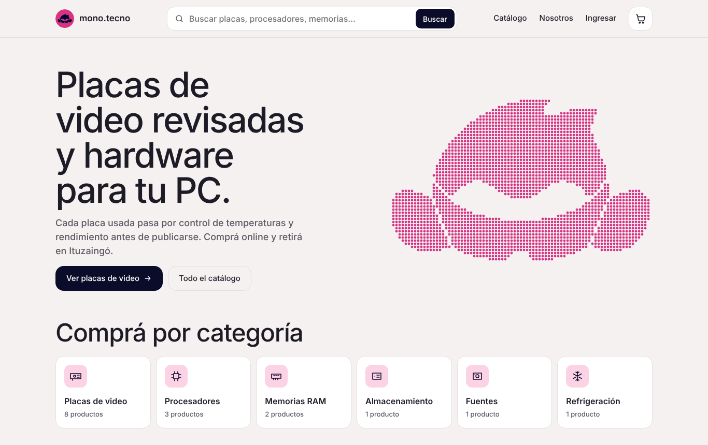 | 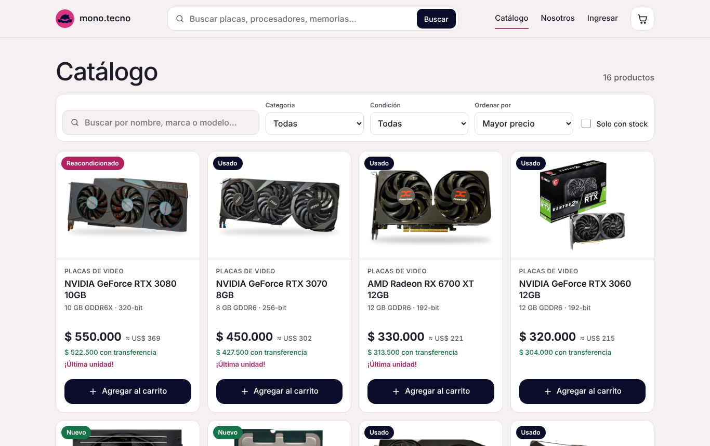 | 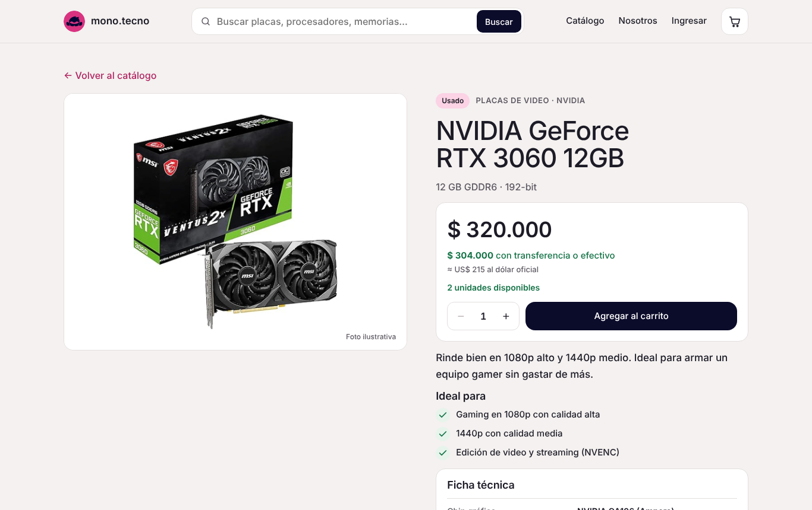 |

| Catálogo (celular) | Catálogo (tablet) | Panel (celular) |
|---|---|---|
| 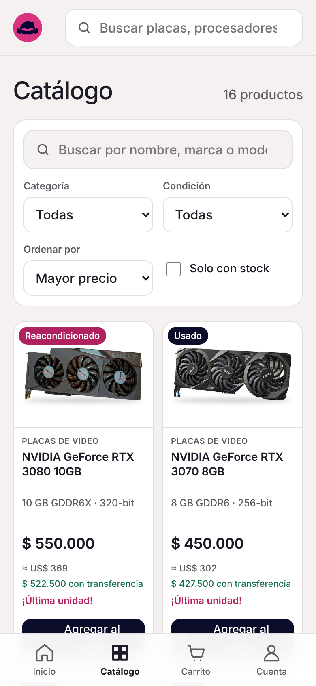 | 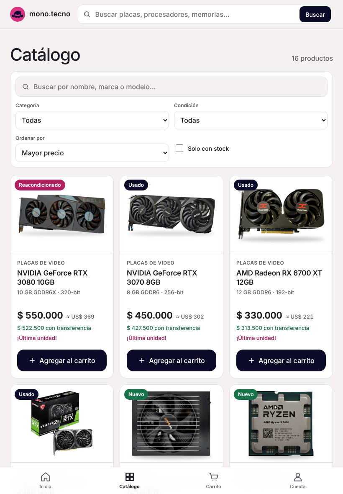 | 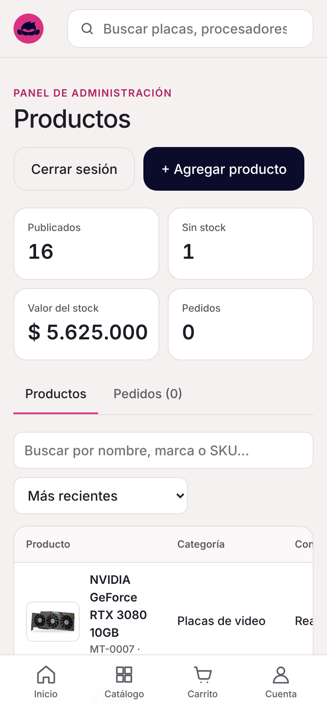 |

| Checkout con validaciones | Pedido confirmado | Crear cuenta |
|---|---|---|
| 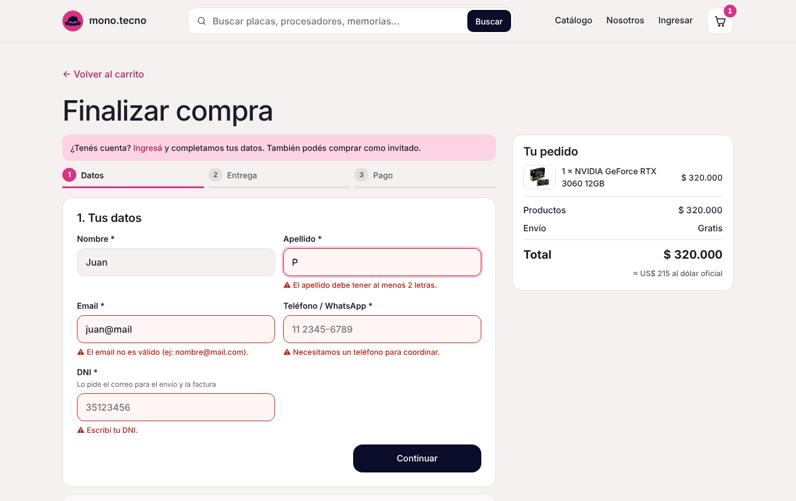 | 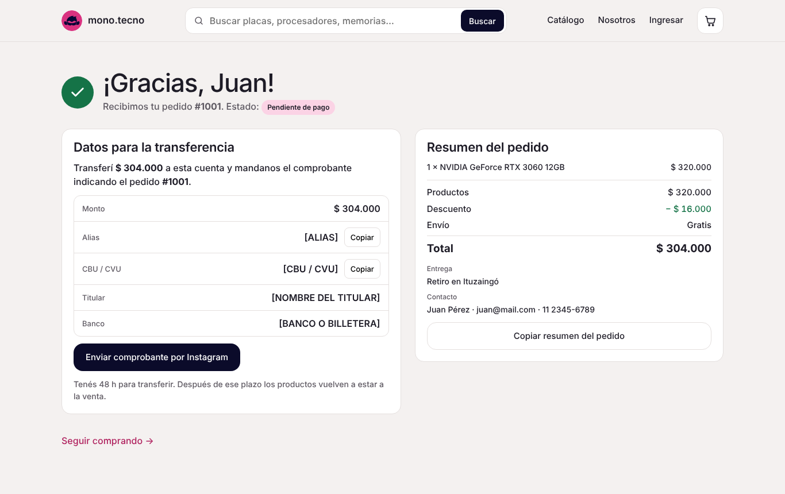 | 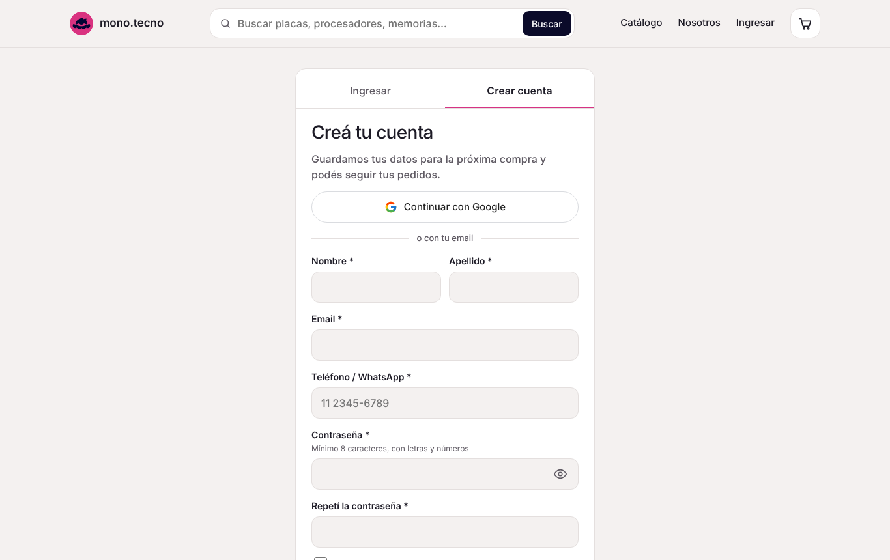 |

| Ingreso al panel | Panel de administración | Alta de producto con errores |
|---|---|---|
| 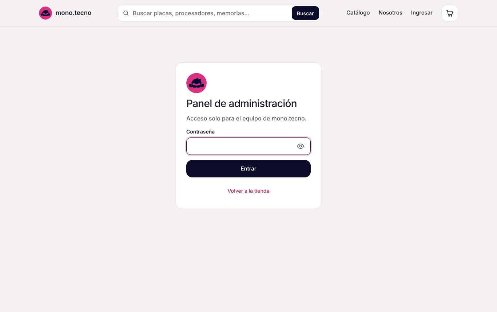 | 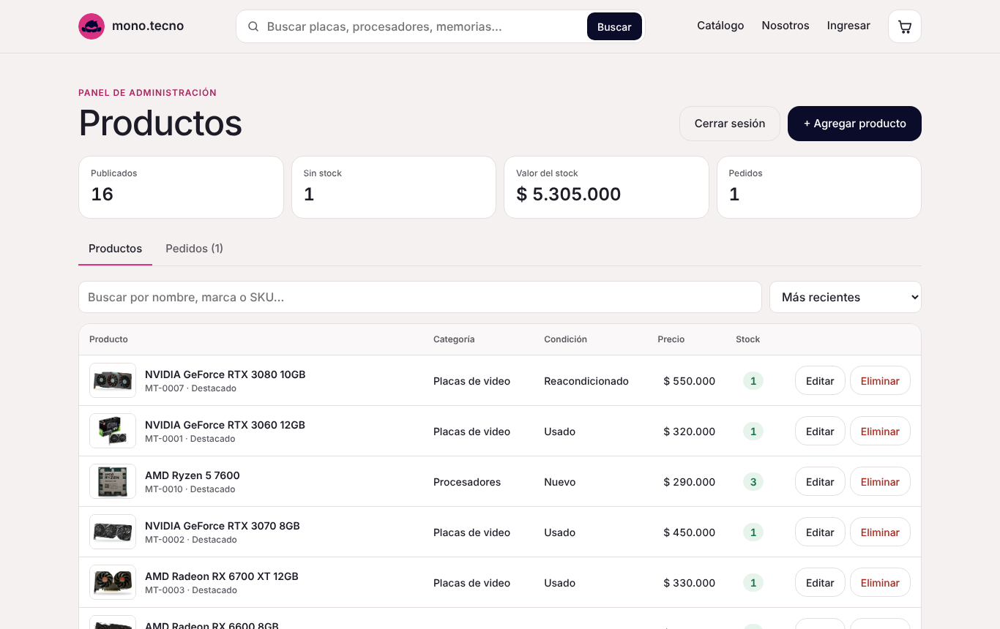 | 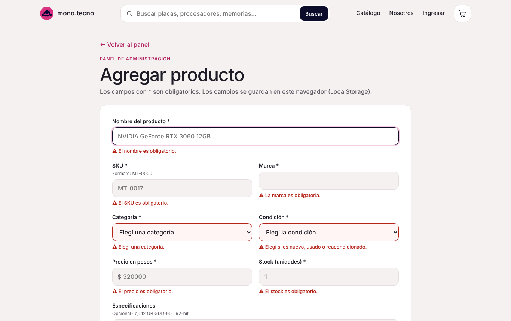 |

| Nosotros (Acerca de) |
|---|
| 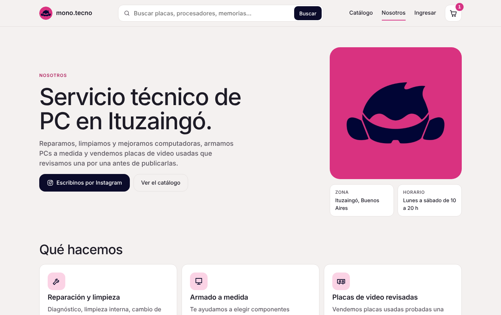 |

## Notas

- **Fotos**: todas en 1200×900, sobre fondo blanco. La RTX 3060 usa la foto original de mono.tecno; las demás son de Wikimedia Commons con licencias libres, con el fondo quitado (créditos en `CREDITOS.md`). Algunas son ilustrativas de un modelo parecido.
- **Precios**: los de las placas de video son los que publicaba mono.tecno; los del resto de los productos son de ejemplo.
- Para volver al catálogo inicial: Panel → "Restaurar el catálogo inicial".
